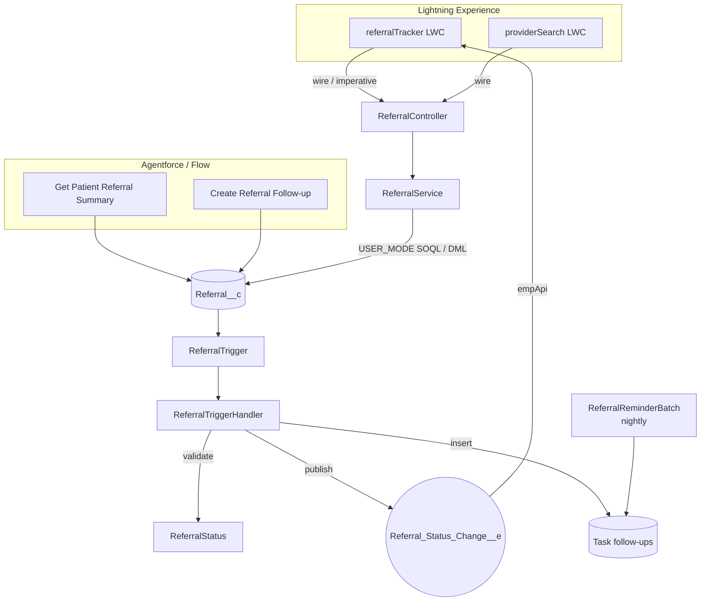

# Health Cloud Referral Tracker (clean-room demo)

A referral and care-coordination workflow for Salesforce: a Lightning Web Component that shows a
patient's referrals with valid next-step actions, live updates over Platform Events, a nightly
overdue-reminder job, and two **Agentforce-ready invocable actions** that let an AI agent or a Flow
summarize referrals and create follow-ups.

> **Representative portfolio project.** I built a production referral workflow on Health Cloud for a
> healthcare client. This repository is an independent, clean-room re-implementation of the *pattern*
> written from scratch on a simplified custom data model with **synthetic data only**. It contains no
> client code, configuration, data, architecture documents or PHI, and it does not use the Health
> Cloud managed package, so it deploys to a free Developer Edition or scratch org.

## Business problem

Care coordinators were tracking referrals in email and a shared spreadsheet. Nobody could see at a
glance which referrals were waiting on a provider, which were overdue, or who had touched them last,
so patients slipped through. The goal: one view per patient, enforced status rules, automatic
reminders and an audit trail.

## Features

| Area | What it does |
|---|---|
| `referralTracker` LWC | Patient record component: referral table, open/overdue counts, row actions limited to valid next statuses, toast feedback, auto-refresh on `Referral_Status_Change__e`. |
| `providerSearch` LWC | Debounced provider search by name and specialty. Works on record pages, app pages and Flow screens; emits `providerselect`. |
| Status rules | `ReferralStatus` defines allowed transitions once; enforced in the service layer **and** the trigger so API and data-loader updates follow the same rules. |
| Platform Events | Status changes publish `Referral_Status_Change__e` (after commit) for UI refresh and downstream subscribers. |
| Reminders | `ReferralReminderBatch` (Batchable + Schedulable) creates one reminder per overdue referral and never duplicates an open reminder. |
| Agentforce actions | `GetReferralSummaryAction` and `CreateReferralFollowUpAction` are `@InvocableMethod`s with planner-friendly labels and descriptions. |
| Security | `with sharing`, `WITH USER_MODE` queries, `as user` DML, private sharing model, permission set with explicit field access, field history tracking. |

## Architecture



## Data model (synthetic)

- `Referral__c`: Patient (Contact), Provider (Account), Status, Priority, Specialty, Reason, Follow-up Due Date, Status Changed At. History tracking on key fields.
- `Account`: `Specialty__c`, `Accepting_Referrals__c` (providers).
- `Referral_Status_Change__e`: Referral Id, Patient Id, Old Status, New Status.

Allowed transitions: `Draft → Sent | Cancelled`, `Sent → Scheduled | Cancelled`, `Scheduled → Completed | Cancelled | Sent`, `Cancelled → Draft`.

## Setup

Prerequisites: Salesforce CLI, a Dev Hub (free Developer Edition works), Node.js 20+.

```bash
git clone https://github.com/arifkhanshaukat-bot/health-cloud-referral-tracker.git
cd health-cloud-referral-tracker
npm install

sf org create scratch --definition-file config/project-scratch-def.json --alias referrals --set-default
sf project deploy start
sf org assign permset --name Referral_Tracker_User
sf data import tree --plan data/sample-plan.json      # synthetic patients, providers, referrals
sf org open
```

Then add **Referral Tracker** to the Contact record page in Lightning App Builder.

Schedule reminders (Execute Anonymous):

```apex
System.schedule('Referral reminders', '0 0 6 * * ?', new ReferralReminderBatch());
```

### Using the Agentforce actions

In an org with Agentforce enabled: **Agentforce Builder → your agent → Topics → New Topic** (for
example "Referral status"), then **Add action → Apex** and choose *Get Patient Referral Summary* and
*Create Referral Follow-up*. The `@InvocableVariable` descriptions tell the planner what each input
means. Both actions also work as Flow actions without Agentforce.

## Tests

```bash
npm test                                   # LWC Jest tests
sf apex run test --test-level RunLocalTests --code-coverage --result-format human
```

| Suite | Covers |
|---|---|
| `referralTracker.test.js` | Row mapping, overdue logic, valid row actions, empty and error states, success and failure toasts, empApi subscription |
| `providerSearch.test.js` | Debounce, specialty filter, selection event, empty and error states |
| `ReferralService_Test` | Ordering, valid/invalid transitions, **200-record bulk** trigger validation, provider search, controller error wrapping |
| `ReferralReminderBatch_Test` | Overdue detection, no duplicate reminders, scheduling |
| `ReferralAgentActions_Test` | Summary counts and text, no-referral case, follow-up creation, missing-record handling |

CI (`.github/workflows/ci.yml`) runs ESLint, Jest with coverage and a gitleaks secret scan on every
push; it also runs the Apex tests in a scratch org when an `SF_DEVHUB_AUTH_URL` secret is configured.

## Security and privacy

- All sample data is fictional (`data/`), uses `example.com` addresses and `555` numbers, and is labelled *Synthetic* / *Demo*.
- No credentials, endpoints, org Ids or tokens are stored in the repo; `.gitignore` excludes auth files.
- Apex enforces sharing and FLS (`with sharing`, `WITH USER_MODE`, `as user`); the reminder batch
  runs in system context by design because it is a scheduled job, and only creates Tasks.
- Do not load real patient data into a demo or scratch org.

## Limitations and next steps

- Uses a simplified custom object rather than Health Cloud's `ClinicalServiceRequest` / care-plan objects.
- No Experience Cloud (patient-facing) view yet.
- Planned: OmniScript intake version, Prompt Builder template for referral letters, Salesforce Code Analyzer step in CI.

## License

MIT, see [LICENSE](LICENSE).

## Author

Arif Khan, Senior Salesforce Developer (Health Cloud, OmniStudio, Apex/LWC, integrations).
[LinkedIn](https://www.linkedin.com/in/arif-khan-99102a427) · [GitHub](https://github.com/arifkhanshaukat-bot)
